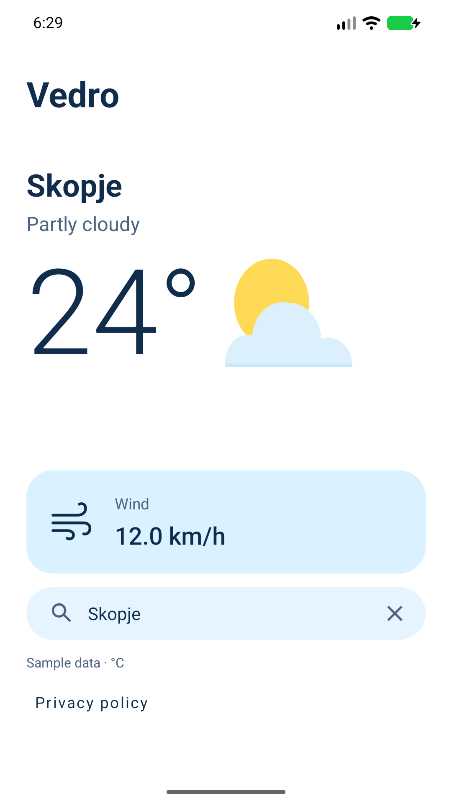
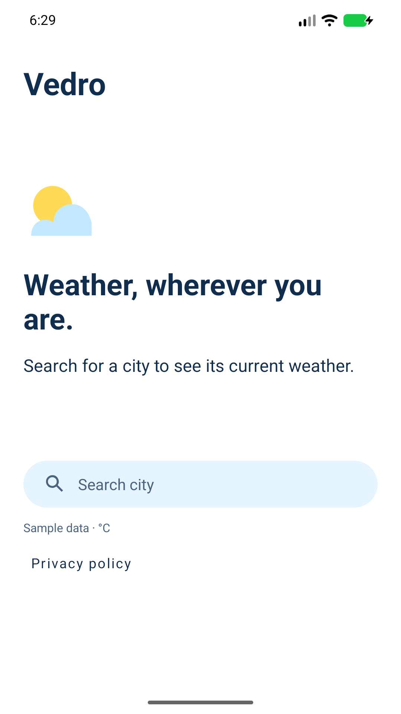
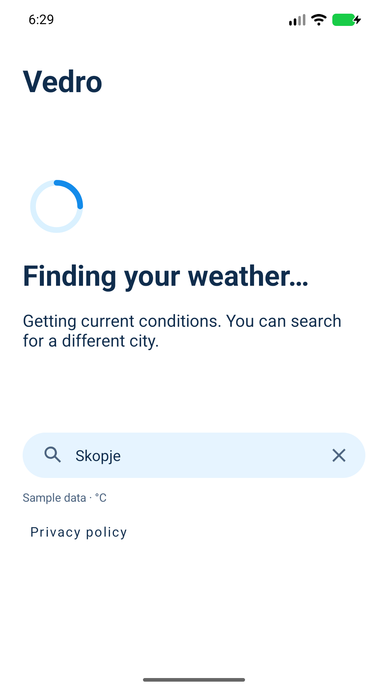
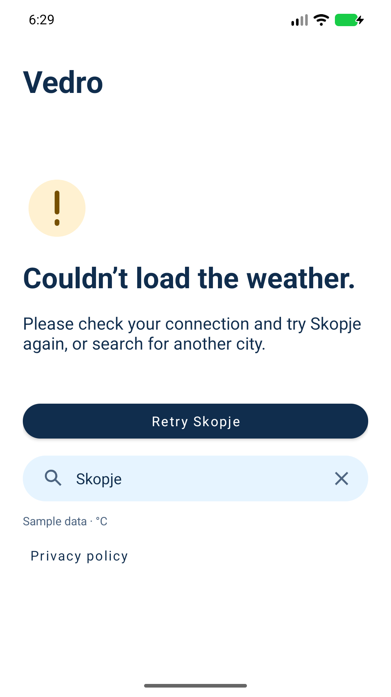

# Quiet precision UI review

Native Java/XML implementation of the approved [main screen](https://www.figma.com/design/VbRn3P6xJFkdwIG4I1pB8X?node-id=4-1207) and [supporting states](https://www.figma.com/design/VbRn3P6xJFkdwIG4I1pB8X?node-id=6-50).

The UI branch is based on merged branding commit `ac0928051de56f3f4adbd6a6f4021bd8167550f6`. It uses the existing Vedro app-name resource, current-weather provider and retained ViewModel. The UI commit leaves the Vedro name and Clear sky launcher resources unchanged.

The five Figma assets (sun/cloud, wind, empty, loading and error) were downloaded and converted directly to Android vectors, preserving their paths, fills, strokes, viewports and dimensions. The partly cloudy illustration is shown only for matching daytime condition/icon pairs 801/02d and 802/03d. Nighttime, missing or unknown icon metadata, and other conditions use their textual description without that illustration. The loading illustration is static in this first pass. Both system appearance modes use the selected light palette.

Search remains available during loading and errors. Explicit retry uses the failed request's city, including after activity recreation or edits to the unsubmitted query. The current app uses manual city search only, without device-location permissions or services. Search, results and pending requests survive activity recreation through the existing ViewModel.

## Manual-city-only validation (2026-10-25)

**17 unit tests** and **13 fixture tests on the isolated API 37 ARM64 emulator**
passed. Debug/release lint reported zero issues. Debug/test/release APK and ordinary
release AAB builds passed; release isolation verified an empty key, production
identity and no debug fixture activities. Both merged manifests and the resolved
release graph contain no location permissions or Google Play services components.
The new regression checks the installed app has no location permissions, starts
idle and remains idle through recreation until a manual city is submitted.

Current screenshots below are genuine key-free API 37 fixture captures from this
revision, including the privacy link. No live weather or actual location was used.
The task's emulator was read-only, stopped after QA, and no AVD data was wiped.

## Historical UI release-review regression fixes

Day/night icon metadata is retained, and the sun artwork requires a matching daytime pair. Rounded temperatures between −0.5°C and 0.5°C display unsigned zero while the precise accessibility value is preserved. The manual release requires an explicitly entered fresh version code with no default; the live freshness guard and protected owner gate remain in place.

Validation: **25 unit tests**, **12 fixture UI tests**, debug/release lint with no issues, debug/test APK and release bundle builds, and key-free release verification passed. UI fixtures cover transitions through day, night, missing and unknown icon metadata plus `0°` with a precise negative accessibility value. Unit cases cover both ±0.5°C rounding boundaries. Workflow checks reject reintroduced version defaults and an optional version field. No release or live API call was made.

## Historical original UI validation

- Debug app and instrumentation APK builds; ordinary release bundle build.
- Debug and release lint: **no issues**.
- **23 unit tests** and **11 fixture instrumentation tests** passed. Final fixture acceptance ran with the tall cutout overlay enabled; an earlier targeted inset run also passed.
- Instrumentation covers actual keyboard search, empty/loading/error/success, explicit retry after recreation, late older responses, pending/success recreation, landscape rotation, permission refusal and manual search, missing configuration, safe system-bar insets, and search/location reachability at **200% font size**.
- **9 debug-key helper tests**, **23 CI safety tests**, and workflow validation passed.
- Ordinary release verified: empty API key, correct package, nondebuggable, no fixture activities. The local verification used only the resolved build-tool dependencies to avoid conflicting older versions in the pre-existing dependency cache.

The original UI screenshots contained synthetic in-memory data. No live weather API was called, no provider key was configured, and no APK or bundle was uploaded. QA ran on a separate local API 36 ARM64 emulator with the app's unchanged target SDK 37. API 37 device testing, physical-device testing and live-provider acceptance remain outside this verification.

## Current manual-city-only screenshots

| Current weather | Empty | Loading | Error and retry |
| --- | --- | --- | --- |
|  |  |  |  |

[200% fonts](quiet-large-font.png) · [Landscape, scrolled to actions](quiet-landscape.png) · [Historical tall cutout](quiet-cutout.png)

Landscape uses the same vertical, scrollable screen; this screenshot shows the actions after scrolling. System bars, keyboard and display cutouts are excluded from the scroll viewport.
